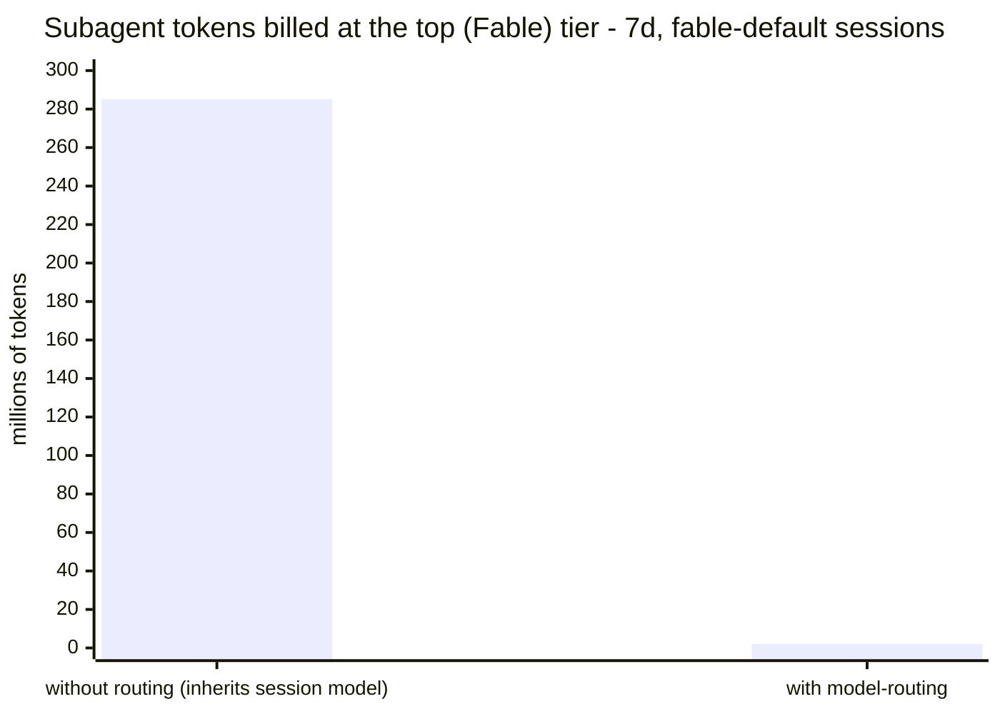
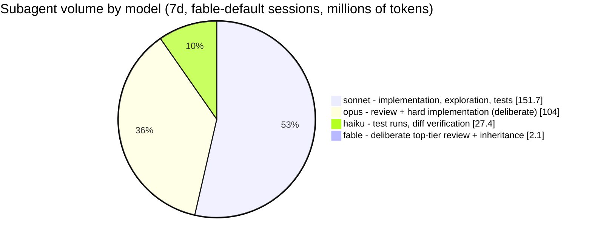
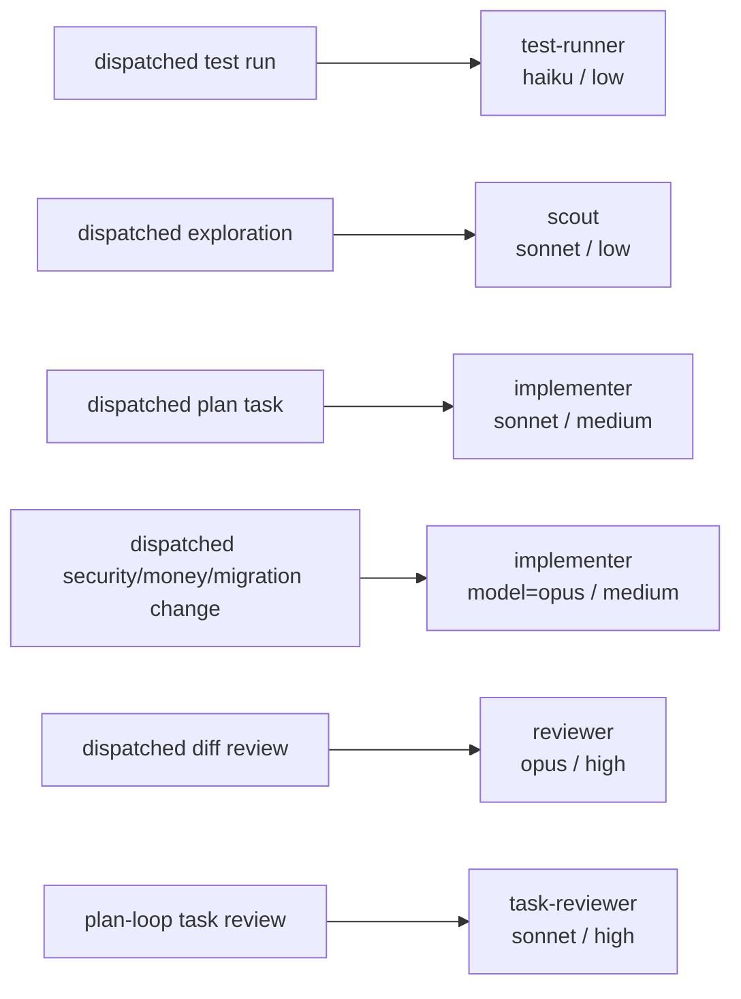

# When this saves you money, and when it does not

Read this before installing, because the honest answer has two halves and
[`evals/`](/benchmarks/evals) measured both.

**A subagent is not free.** It starts with an empty context, so everything it
reads is a cache *write*, while your main session pays cache *read* - 12.5x
cheaper, 25x on Opus 5.5 and Sonnet 5.5, 50x on Fable and Mythos 5.2 and 5.1 - for what it already has. Delegation converts cheap re-reads into
expensive first-reads, and that bill lands whether or not this plugin is
installed.

What the plugin changes is the price per token, not that penalty. So:

| Your situation | What this plugin does |
| --- | --- |
| You already dispatch subagents (Superpowers, workflows) | **Saves** - roughly a sixth on the one measured workload: $1.68 with the tier routed down, against $2.01 for the same subagent work repriced at your session's tier |
| You work mostly in one session and rarely delegate | **No extra dispatches** since 0.17: the anchor no longer recommends dispatching, so what remains is the always-on surcharge below - about 1.9k cache-write tokens per session in the small-case runs. On Opus 5.5 (Claude Code 2.1.330, two runs an arm) neither arm dispatched on either case; the small case cost $0.116 with the plugin against $0.099 without (+17%, all surcharge on a 7-second session), the wide case $2.119 against $2.094 (+1%) ([evidence files](/benchmarks/evidence)). Up to 0.16 it pushed dispatches that would not otherwise have happened, and on this workload that cost roughly a fifth: $1.36 doing it inline against $1.68 routed |

One workload, three runs an arm, on a four-turn session that never had to
compact - so read the direction as solid and the exact percentage as not.
The $2.01 is the measured subagent tokens repriced at the session tier, not
a run of its own; the pricing model reproduces the billed figure it was
checked against to the cent, but a live top-tier subagent might well read
less and narrow the gap.

An unpinned subagent inherits the session model, so on an opus session
Superpowers dispatches opus subagents by default. That is the case this plugin
is for: the dispatch was going to happen anyway, and routing it down is a
discount whose only cost is the always-on surcharge below.

Note what the surcharge is and is not. The plugin costs about 1.9k tokens a
session to carry - measured on 2.1.330 as the cache-write difference between
the small-case arms (10309/10287 against 8413/8412), of which the 2021-byte anchor measured then was
about 700 and the remaining ~1.2k the skill and agent listings - which is a
couple of cents against sessions billing $1.40 to $2.00. The anchor
is now 1861 bytes, about 620 tokens at the ratio an earlier cut measured: on the same eval
case and CLI, the 3225-byte anchor wrote about 630 fewer cache tokens per
run than the 5114-byte one it replaced
([`evals/evidence/small-case-opus55-*-anchor.json`](https://github.com/AqueGen/model-routing/tree/main/evals/evidence)). The
committed `claude plugin details` output in [`evals/evidence/`](https://github.com/AqueGen/model-routing/tree/main/evals/evidence)
(~700 tokens) is older - 0.14.0, seven agents - and lower than the
subtraction above. That is not where the 23% comes from. It comes from dispatches happening
that otherwise would not have: on the same question the plugin arm delegated in
3 runs of 3 and the plugin-free arm in 0 of 3. That was measured on 2026-08-17; on
2026-10-02 an Opus 5.5 session answered the
same question with one grep and one read and delegated in 0 of 2 under both the
old and the current anchor, so this case no longer separates the arms on Opus
5.5 ([`evals/evidence/small-case-opus55-*-anchor.json`](https://github.com/AqueGen/model-routing/tree/main/evals/evidence)). Since 0.17 the anchor and the
skill no longer recommend dispatching at all - they only route a dispatch
that something else asked for - so the plugin should no longer move that
split in either direction, and only the discount remains.

(The A/B that would replace the repricing with a run is still blocked, for the
reason written down in `evals/forced-dispatch-tier/NOTES.md`.)

## What that looks like in tokens

**Snapshot: 2026-08-02, measured with v0.13.0** - the author's live workload over the preceding 7 days, via `dispatch-counter.mjs tokens`, `... tokens --session fable` and `... report --session fable`. A fixed snapshot, not a live figure: the rolling window moves daily and your split depends on your task mix - re-measure your own with the same commands. It was taken under the 0.13 anchor, which still recommended dispatching, so part of this subagent volume was caused by the plugin itself.

**Read the scope before the numbers,** because there are two of them and they are easy to mix up.

| | All sessions | Fable-default sessions (the charts below) |
| --- | --- | --- |
| Main-session volume, not routable | 6.85B | 1.08B across 33 sessions |
| Subagent volume, routable | 1.77B | 285.2M across 103 agents |
| Subagents as a share of the total | 21% of 8.64B | 21% of 1.36B |
| Ran below the session tier | 33% | 99% |

Two things follow. First, the main session is not in any chart here and never can be: its model is fixed for the turn, so no routing decision moves it. Routing governs about a fifth of what was actually spent, and the charts describe how well it governs that fifth - not how much of the bill it removes. Second, the 99% belongs to the fable-scoped column: on an opus-default session an opus subagent is not a step down, so there is little room to route anywhere, which is most of the gap between 99% and 33%. Both figures are true, and `tokens` now prints them together so the flattering one is never read alone.

The charts below take the fable-scoped column. In it, 98% of dispatches (82 of 84) and 283.1M of 285.2M tokens ran below the session tier. Without routing every subagent inherits the session model, so the whole 285.2M would bill at Fable prices; with routing 2.1M did:

**That left bar is an upper bound, not a measurement.** It assumes every subagent would otherwise inherit the session model, which is the documented default for an UNPINNED agent - but pinned agents exist independently of this plugin. Other installed plugins ship their own pinned agents, and Claude Code's built-in `Explore` ran haiku before Claude Code 2.1.198 (since then it inherits the session model, capped at opus). Some of this volume would have run cheaply with model-routing uninstalled; how much was not measured, so read the bar as the ceiling of what routing can be credited with rather than the amount it saved.

Attribution over the same week, across all 266 dispatches, 199 of which ran below their session tier:

| Mechanism | Dispatches | What it means |
| --- | ---: | --- |
| Agent frontmatter pins shipped by this plugin | 68 | Automatic. The agent file names the tier, so it fires whether or not any routing rule is followed |
| An explicit `model=` on the dispatch | 127 | Behavioural. This is the routing rules being applied, and nothing enforces them |
| Claude Code's built-in `Explore` | 4 | Not this plugin at all |

The honest reading: the automatic half is fully attributable, the behavioural half depends on the session actually following the anchor, and these numbers have no control group of their own - this is the author's own workload measured with the author's own tool, with no before-install baseline. `CLAUDE_CODE_SUBAGENT_MODEL` was not set in this window, which the report would otherwise have annotated per row.

For the behavioural half there is now a control group, just a much smaller one: [`evals/`](/benchmarks/evals) runs the same question with and without the plugin loaded. Up to 0.16 the plugin arm delegated a codebase question to `scout` in 3 of 3 runs and the plugin-free arm in 0 of 3, grepping inline despite having `Explore` available. That push was the cost described above, so since 0.17 the case grades the opposite: the plugin arm should answer inline like the baseline.

The money is a more interesting answer than "it saves". On a wide-reading question across a four-turn session, the expensive tier drops either way - opus spend down 14%, its input volume down about 25% - but up to 0.16 the shipped configuration ended up **23% more expensive in total than not having the plugin at all**, because it caused the dispatch and a fresh subagent pays cache *write* for everything it reads while a main session pays cache *read*, 12.5x cheaper (25x on Opus 5.5 and Sonnet 5.5, 50x on Fable and Mythos 5.2 and 5.1), for what it already has. That is why 0.17 stopped causing dispatches and only prices the ones that happen.

Running that same question with `scout` pinned to haiku (Haiku 4.5) lands about a tenth *below* the no-plugin baseline - which looked like the fix until the tier was asked something subtler. On a question whose code contains a confident-looking wrong answer, Haiku 4.5 took the bait once in three runs and sonnet in none. Three runs cannot pin a failure rate, and the pin did not stay on sonnet because of the rate: it stayed because the failure is asymmetric, since a wrong answer sends the main session back to read the files itself and costs more than the cheaper tier saves. What the two results together support is a split rather than a pin change - breadth to `surveyor` (haiku), judgement to `scout` (sonnet). [`evals/README.md`](/benchmarks/evals) carries the numbers, the arithmetic, and the three isolation attempts that produced numbers worth throwing away.

Where that volume actually ran with routing active:

The opus slice is not a leak - on a Fable session even opus is a cheaper tier, and review plus multi-file implementation were dispatched there deliberately under the 0.13 rules. Multi-file implementation has since moved to sonnet: on `evals/implementer-multi-file` sonnet cost 53% less with every hidden test passing.

The fable slice is worth reading against the previous snapshot (2026-07-20, v0.8.1), where it was 21.4M of 166.8M - mostly Workflow `agent()` calls dispatched with no explicit `model` opt. 0.7.2 added the Workflow routing rule in response to that exact measurement, and the accidental part of this slice is now a rounding error. Most of what remains is the opposite of a leak: a `model=fable` reviewer dispatched ON PURPOSE at the top tier, above the session, to review this release. The counter reports it as above-tier work rather than hiding it, which is the behaviour 0.8.0 added. Tier leaks sit at 1 of 11 unpinned dispatches (9%) - the report states that count, not a verdict on it. The plugin's job is making every slice a decision instead of an accident, and a visible, attributable top-tier slice is what a decision looks like.

Which tier a dispatch lands on, once something has asked for it:

